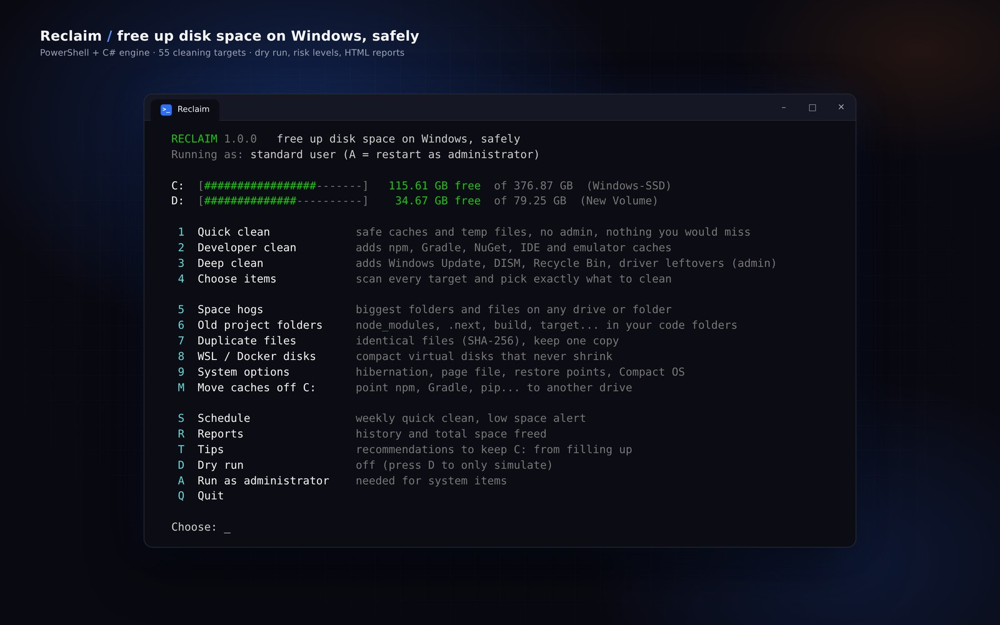
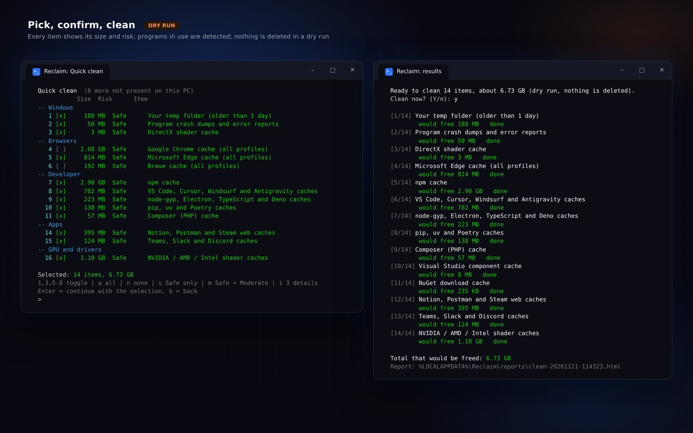
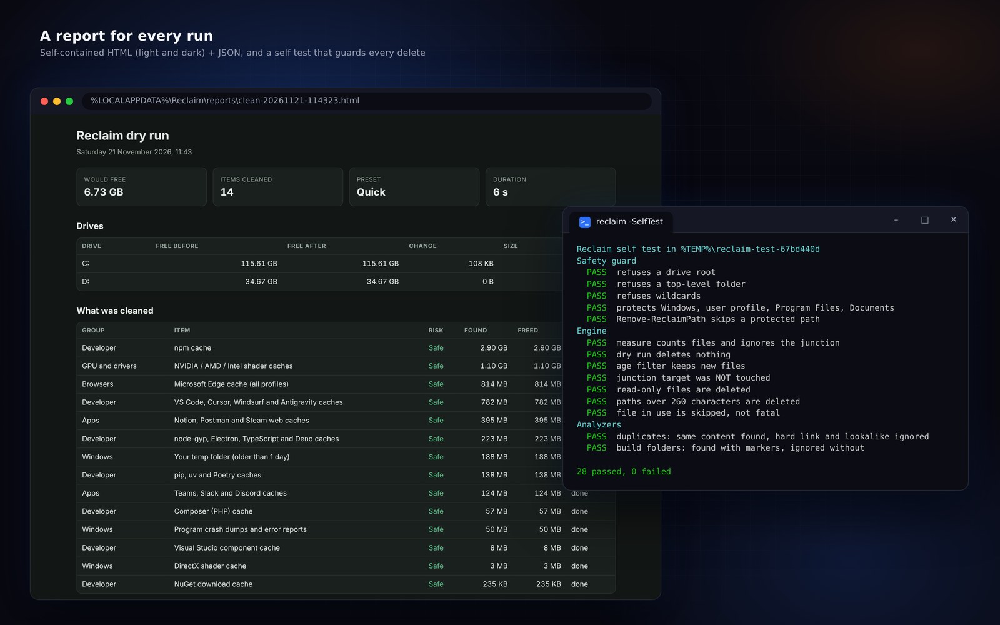

# Reclaim



**Free up disk space on Windows, safely.** A menu-driven cleaner for people whose C: drive keeps filling
up, built for developers: it knows where npm, Gradle, NuGet, pip, Android Studio, JetBrains, VS Code,
Docker and WSL hide their gigabytes, and it never deletes anything without telling you what will
happen afterwards.

```
  RECLAIM 1.0.0   free up disk space on Windows, safely
  Running as: standard user (A = restart as administrator)

  C:  [#################-------]  115.61 GB free  of 376.87 GB  (Windows-SSD)
  D:  [##############----------]   34.67 GB free  of 79.25 GB  (New Volume)

   1  Quick clean             safe caches and temp files, no admin, nothing you would miss
   2  Developer clean         adds npm, Gradle, NuGet, IDE and emulator caches
   3  Deep clean              adds Windows Update, DISM, Recycle Bin, driver leftovers (admin)
   4  Choose items            scan every target and pick exactly what to clean

   5  Space hogs              biggest folders and files on any drive or folder
   6  Old project folders     node_modules, .next, build, target... in your code folders
   7  Duplicate files         identical files (SHA-256), keep one copy
   8  WSL / Docker disks      compact virtual disks that never shrink
   9  System options          hibernation, page file, restore points, Compact OS
   M  Move caches off C:      point npm, Gradle, pip... to another drive
   S  Schedule  R  Reports  T  Tips  D  Dry run  A  Run as administrator  Q  Quit
```

No installation, no dependencies: PowerShell 5.1 (built into Windows 10 and 11) or PowerShell 7.

| Pick and clean | Reports and self test |
| --- | --- |
|  |  |

## Quick start

1. Download or clone this folder anywhere, for example `D:\Tools\reclaim`.
2. Double-click **`reclaim.cmd`**.
3. Press **1** (Quick clean), check the list, press Enter, confirm.

Press **D** first if you only want to see what would happen (dry run). Press **A** to restart as
administrator when you want the system items (Windows Update cache, DISM, all users' Recycle Bins).

## What it does

| Feature | What you get |
| --- | --- |
| **55 cleaning targets** | Windows temp and crash dumps, every Chromium browser and Firefox (all profiles), npm / Yarn / pnpm / Bun, pip / uv / Poetry / Conda, NuGet, Gradle, Maven, Cargo, Go, Composer, pub, JetBrains and Android Studio (including caches of old IDE versions), VS Code / Cursor / Windsurf, Docker, Teams / Slack / Discord, GPU shader caches, NVIDIA driver downloads, Android emulator snapshots, Windows Update, Delivery Optimization, DISM component store, Windows.old. Full list: [docs/TARGETS.md](docs/TARGETS.md). |
| **Risk levels** | Every target is **Safe**, **Moderate** or **Careful** and says what happens after cleaning ("the next Gradle build downloads dependencies again"). Careful items are never in a preset and need you to type `YES`. |
| **Presets** | Quick (safe, no admin), Developer (adds caches that are rebuilt), Deep (adds system items, admin). Or pick items one by one. |
| **Space hogs** | Scans a whole drive in a background thread (about 1 minute for 600,000 files), shows the biggest folders and files, file types, data untouched for a year, and marks folders Reclaim can clean. Drill into a folder, open it in Explorer, or send files to the Recycle Bin. |
| **Old project folders** | Finds `node_modules`, `.next`, `.nuxt`, `.turbo`, `target`, `build`, `.gradle`, `.dart_tool`, `bin/obj`, `__pycache__`, `.venv`, `vendor`, `Pods`, `.terraform` in your code folders, only when the project file next to them exists (`package.json`, `Cargo.toml`, `*.csproj`...), and preselects projects untouched for 30 days. |
| **Duplicate files** | Same size, then a quick hash of the first and last 64 KB, then full SHA-256. Hard links are recognised and never reported as duplicates. Keep the oldest, newest or shortest-path copy; the others go to the Recycle Bin. |
| **WSL / Docker disks** | Finds every WSL distro (from the registry) and Docker Desktop disk, runs `fstrim` inside the distros, shuts WSL down and compacts the `.vhdx` files with `diskpart`. Optionally switches WSL to sparse mode so disks shrink by themselves. |
| **Move caches off C:** | Points npm, Yarn, pip, uv, NuGet, Gradle, Puppeteer, Playwright and Hugging Face to a folder on another drive (user environment variables) and removes the old copy on C:. Keeps `gradle.properties` and `init.d`. |
| **System options** | Hibernation file: shrink it to "reduced" (keeps Fast Startup) or turn it off. Page file and restore point information, Compact OS, DISM analysis, Storage Sense, Disk Cleanup. |
| **Reports** | Every clean and every scan is saved as a self-contained HTML page (light and dark mode) and JSON in `%LOCALAPPDATA%\Reclaim\reports`. `history.csv` keeps the total space freed over time. |
| **Schedule** | A weekly hidden Quick clean, and a daily low-space notification (Windows toast) when a drive drops under 20 GB. Both are normal Task Scheduler tasks you can see and delete. |
| **Command line** | Everything also works without the menu, for scripts and CI. See below. |

## Safety design

Deleting files is the one thing a cleaner must never get wrong, so Reclaim is built around it:

- **Junctions and symbolic links are never followed.** A link inside a cache is removed as a link; the
  folder it points to is never touched. A junction inside `node_modules` or a tool's cache can point
  anywhere, so this matters.
- **Two independent guards.** The PowerShell layer refuses protected folders (drive roots, Windows,
  System32, WinSxS, Program Files, ProgramData, Package Cache, Windows\Installer, your profile, Documents,
  Desktop, Downloads, Pictures, OneDrive, `.ssh`, and Reclaim's own folder) plus anything you list in
  `ExcludePaths`. The C# engine then refuses wildcards, relative paths and anything less than three levels
  deep (`C:\a\b`), with a few explicit exceptions such as `C:\Windows.old`.
- **Programs in use.** If Chrome, an IDE or the Android emulator is running, Reclaim asks you to close it,
  skip the item, or clean anyway; files that are locked are skipped and counted, never forced.
- **Dry run everywhere** (`D` in the menu, `-DryRun` on the command line) gives the exact sizes without
  deleting anything.
- **Your data goes to the Recycle Bin.** Duplicates, big files, old installers and phone backups are
  recycled, not deleted. Caches, which programs rebuild by themselves, are deleted permanently.
- **Long paths** (over 260 characters, common in `node_modules`) and read-only files are handled.
- **Logged.** Every action is written to `%LOCALAPPDATA%\Reclaim\logs`.
- **Tested.** `reclaim -SelfTest` builds a throw-away folder tree in `%TEMP%` (with a junction to a
  "precious" folder, locked, read-only, old and very long paths, duplicates and hard links) and checks
  28 rules, including that the junction target survives.

What Reclaim will **not** do: touch `WinSxS`, `Windows\Installer` or `Package Cache` by hand (it uses DISM
instead), delete restore points, registry "cleaning", or delete anything in Documents, Desktop or Pictures
except files you pick yourself.

## Command line

`reclaim.cmd` passes everything to `Reclaim.ps1`. Comma-separated lists work: `-Targets a,b`.

```bat
reclaim                                     :: interactive menu
reclaim -List                               :: all targets with id, risk, presets
reclaim -Scan                               :: measure everything, delete nothing
reclaim -Scan -Preset Dev -Json             :: measure one preset, as JSON
reclaim -Clean -Preset Quick                :: clean a preset (asks once)
reclaim -Clean -Preset Quick -Yes -Quiet    :: no questions, no output (for Task Scheduler)
reclaim -Clean -Targets npm-cache,gradle-caches -DryRun
reclaim -Clean -Targets android-avds -Force :: Careful items need -Targets and -Force
reclaim -Clean -Preset Dev -Skip chrome-ai-model
reclaim -Analyze C:\                        :: space hogs, saves an HTML report
reclaim -DevFolders D:\Code                 :: list build folders, mark stale ones
reclaim -DevFolders D:\Code -StaleDays 60 -Clean
reclaim -Duplicates D:\Photos -MinMB 5      :: list duplicate groups
reclaim -Schedule weekly -At 13:00          :: weekly Quick clean   (also: daily, monthly)
reclaim -Schedule alert                     :: low disk space notification
reclaim -Schedule status | remove
reclaim -CheckSpace                         :: exit code 1 and a notification if a drive is low
reclaim -SelfTest                           :: safety and engine tests
```

Other switches: `-NoReport`, `-Pause` (wait for Enter at the end), `-Menu disks|system|dev|space|duplicates|relocate`.
Exit codes: `0` done, `1` error, `2` finished with some items failing.

Set `RECLAIM_PWSH=1` to make `reclaim.cmd` use PowerShell 7 when it is installed.

## Configuration

Defaults are in [`config/settings.psd1`](config/settings.psd1). Put your own values in
`config/settings.local.psd1` (ignored by git), for example:

```powershell
@{
    DevRoots     = @('D:\Code', 'C:\Users\me\source\repos')
    StaleDays    = 45
    LowSpaceGB   = 30
    ExcludeTargets = @('spotify-cache')
    ExcludePaths   = @('D:\Code\keep-this-build')
}
```

Add your own folders as targets in `config/custom-targets.psd1`; copy
[`config/custom-targets.example.psd1`](config/custom-targets.example.psd1) to start. Each target is a few
lines of data: id, name, risk, paths (with `%VARIABLES%` and `*` wildcards), and what happens after cleaning.

## How it works

```
reclaim.cmd ─► Reclaim.ps1 ─┬─ src/Core.ps1      settings, guard, path expansion, engine loader, prompts
                            ├─ src/Targets.ps1   catalog, presets, measure and clean a target
                            ├─ src/System.ps1    special cleaners (DISM, Windows Update, Docker, pnpm,
                            │                    conda, Windows.old...), WSL disks, hibernation, schedule
                            ├─ src/Analyze.ps1   space hogs, old project folders, duplicates
                            ├─ src/Report.ps1    HTML / JSON reports and history
                            ├─ src/UI.ps1        menus and the item picker
                            └─ src/Engine.cs     C# engine, compiled once with Add-Type and cached
```

The heavy work (walking millions of files, deleting, hashing) is done by `Engine.cs`, a small C# library
that PowerShell compiles on first start and caches in `%LOCALAPPDATA%\Reclaim\engine`. It runs on a
background thread, so the console shows live progress and **Esc** stops any scan. It reads file sizes from
the directory listing (no extra disk access per file), uses `\\?\` paths for long names, measures real
size on disk for sparse `.vhdx` files, and identifies hard links by volume and file index.

The cleaning targets are data, not code: `config/targets.psd1` is the whole catalog, and
[`docs/TARGETS.md`](docs/TARGETS.md) is generated from it.

## Development

```powershell
powershell -ExecutionPolicy Bypass -File tools\check.ps1        # parse, ASCII check, compile engine, self test
powershell -ExecutionPolicy Bypass -File tools\gen-targets-doc.ps1
```

Scripts stay ASCII-only so Windows PowerShell 5.1 reads them correctly without a BOM, and avoid
PowerShell 7-only syntax. See [docs/DEVELOPMENT.md](docs/DEVELOPMENT.md) for adding a target or a handler.

## More

- [docs/TARGETS.md](docs/TARGETS.md): every target, its risk and what happens after cleaning
- [docs/RECOMMENDATIONS.md](docs/RECOMMENDATIONS.md): how to keep C: from filling up again
- [docs/DEVELOPMENT.md](docs/DEVELOPMENT.md): architecture, adding targets, testing
- [CHANGELOG.md](CHANGELOG.md)

## License

MIT, see [LICENSE](LICENSE). Use at your own risk: Reclaim tells you what it will delete, but you decide.
